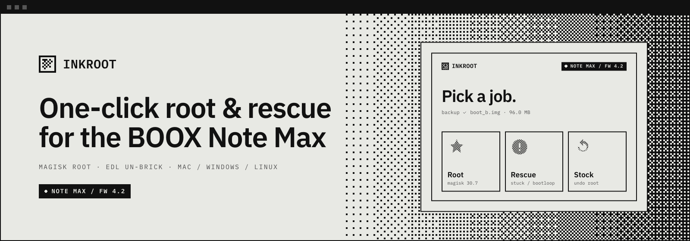
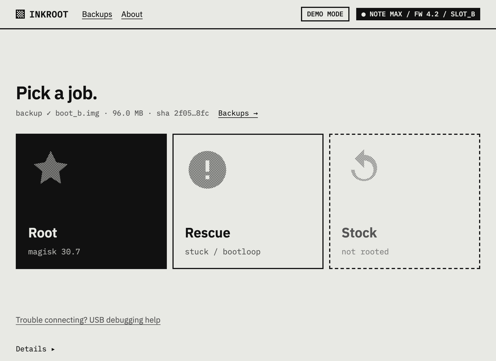
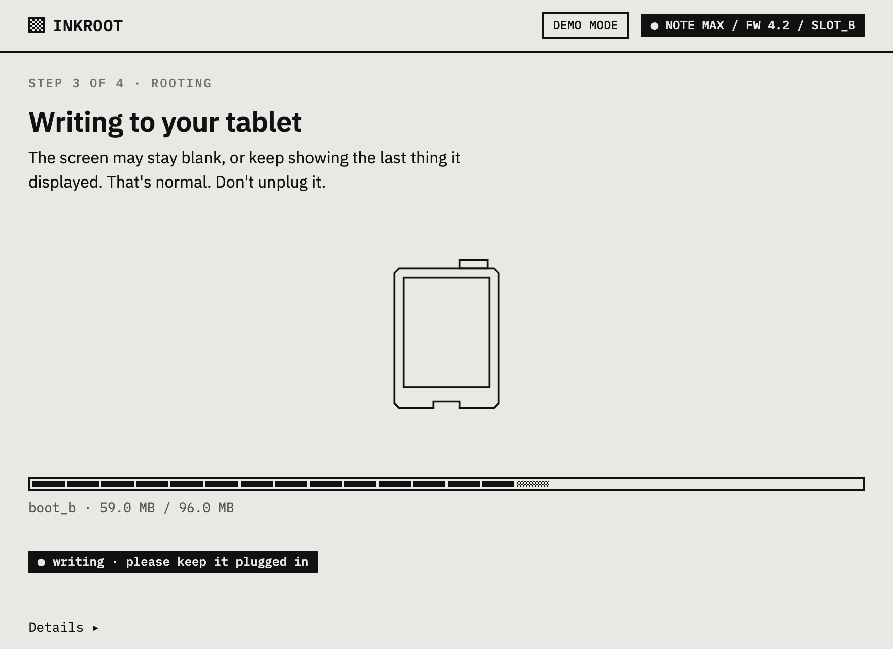
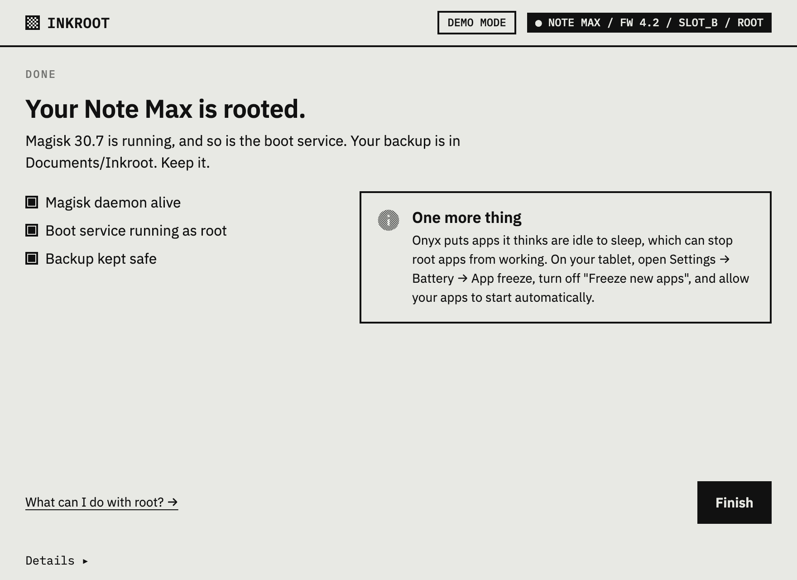
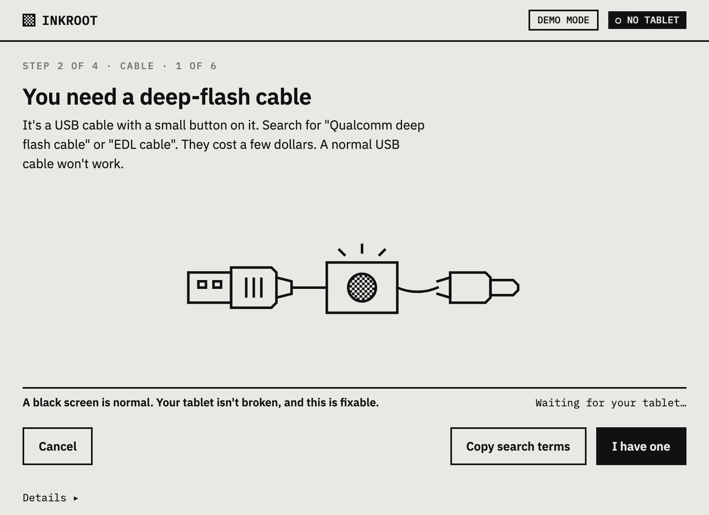

<picture>
  <source media="(prefers-color-scheme: dark)" srcset="assets/readme/hero-dark.png">
  
</picture>

# Inkroot

**One-click root and rescue for the ONYX BOOX Note Max.**

Inkroot roots your BOOX Note Max with Magisk, un-bricks it over Qualcomm EDL when it's stuck on
the logo, and puts it back to stock — on Mac, Windows and Linux, without a terminal.

[Download](#download) · [How it works](#how-it-works) · [Stuck on the logo?](#is-your-boox-stuck) · [Safety](#safety) · [FAQ](#faq) · [For tinkerers](#for-tinkerers)

---

## Download

**Beta — not yet hardware-verified.** Inkroot hasn't been tested end-to-end on a real tablet yet,
so expect rough edges — and keep your safety copy.

| Your computer | Download |
|---|---|
| Mac with Apple Silicon (M1 and newer) | [**Inkroot-macOS-AppleSilicon.dmg**](https://github.com/n0dal/inkroot/releases/latest/download/Inkroot-macOS-AppleSilicon.dmg) |
| Mac with Intel | [**Inkroot-macOS-Intel.dmg**](https://github.com/n0dal/inkroot/releases/latest/download/Inkroot-macOS-Intel.dmg) |
| Windows 10/11 (64-bit) | [**Inkroot-Windows-x64-setup.exe**](https://github.com/n0dal/inkroot/releases/latest/download/Inkroot-Windows-x64-setup.exe) |
| Linux (x86_64, AppImage) | [**Inkroot-Linux-x86_64.AppImage**](https://github.com/n0dal/inkroot/releases/latest/download/Inkroot-Linux-x86_64.AppImage) |

Windows may say *Windows protected your PC*: click **More info → Run anyway** (Inkroot isn't
code-signed on Windows). On Linux, make the AppImage executable first:
`chmod +x Inkroot-Linux-x86_64.AppImage`.

Supports: **BOOX Note Max, firmware 4.2 (`TKQ1.230721.002`)** only. Inkroot checks before it does
anything.

Use at your own risk: modifying your tablet's software can brick it or void its warranty. Inkroot is provided as-is, with no warranty, and is not affiliated with Onyx/BOOX. Read the full [disclaimer](https://github.com/n0dal/inkroot/blob/main/DISCLAIMER.md).

## How it works

1. **Plug in.** Turn on USB debugging and connect your Note Max. Inkroot checks the model, the
   firmware and the battery.
2. **Safety copy.** Inkroot reads your tablet's startup software (the `boot` partition) over
   Qualcomm EDL, checks it twice, and keeps it on your computer. Nothing is written without it.
3. **Root.** Inkroot patches that copy on the tablet with Magisk 30.7, verified boot kept on,
   writes it back, reads it back to check it, and confirms root and the boot service are running.

  
  
  

> [!CAUTION]
> **Is your BOOX stuck on the ONYX logo?**
>
> After a bad boot flash the tablet can look dead, hang on the logo or bootloop. That's almost
> always a soft brick. If you have a copy of its boot image, Inkroot's **Rescue** job walks you
> through the deep-flash cable step by step and writes it back. Your screen may still show the last
> thing it displayed while the tablet is in rescue mode or off, because e-ink keeps its picture. That's
> normal. If the tablet needs a manual restart, hold the power button for up to 30 seconds.
> → [Rescue guide](https://n0dal.github.io/inkroot/rescue/) · [manual EDL guide](docs/02-unbrick-edl.md)
>
> 

## Safety

- **Backup first.** Root refuses to start without a verified stock copy of *this* tablet's
  startup software.
- **Verified boot stays on.** Inkroot always patches with `KEEPVERITY=true KEEPFORCEENCRYPT=true`.
  It isn't configurable: patching with verity off bricks this device.
- **Every write is checked.** Inkroot reads each write back and compares hashes before the tablet
  restarts.
- **Unknown model or firmware is refused.**
- **One job at a time.**
- **"Do you have a rescue cable?"** Inkroot asks before the first write, so you know your way back
  before you need it.

What can go wrong: a write can still fail (cable pulled, power lost). The tablet is then
soft-bricked and **Rescue** writes your safety copy back with a deep-flash cable.

Inkroot collects and sends nothing — no analytics, no telemetry, no account. Your safety copies stay on your computer and are never uploaded.

## FAQ

<b>Will it void my warranty?</b>

It can. Rooting changes your tablet's startup software, and Onyx may refuse warranty service for a
modified device. Inkroot can put the original back (*Return to stock*), but that's no promise your
warranty will be honoured.

<b>Which BOOX models and firmware are supported?</b>

Only the BOOX Note Max on firmware 4.2 (build `TKQ1.230721.002`). Inkroot checks the model and four
firmware fields and refuses anything else, because the wrong firmware can brick the tablet. On
different firmware? [Open an issue](https://github.com/n0dal/inkroot/issues/new/choose) with your
details. Support for other models comes through device profiles.

<b>Which cable do I need?</b>

For backing up, rooting and returning to stock, the normal USB-C cable you charge with. Inkroot
puts the tablet into Qualcomm's download mode (EDL) itself. Only to rescue a tablet that won't
start do you need a **Qualcomm deep-flash (EDL) cable**, plugged into a real USB-A port (USB-C
adapters usually don't work).

<b>How do I turn on USB debugging on a BOOX?</b>

**Turn on USB debugging**

*Method A — Onyx menu (try this first):*
1. Open **Settings → Apps**.
2. Tap the **⋮** menu (top-right) → **USB Debug Mode**, and turn it on.

*Method B — if you can't find it:*
1. Install **Activity Launcher** (free and open source) from F-Droid or Google Play. On a BOOX,
   Google Play may first need to be turned on under **Settings → Apps**.
2. In Activity Launcher, open Android **Settings** (`com.android.settings`).
3. Tap **About tablet**, then tap **Build number** 7 times.
4. Go back to **System → Developer options** and turn on **USB debugging**.

Then plug the tablet into your computer, tap **Allow** on "Allow USB debugging?", and tick
**Always allow from this computer**.

> Method A comes from field notes and hasn't been confirmed on firmware 4.2 hardware yet. If it
> isn't there on your tablet, Method B works on any Android 13 build.

<b>Why can't the Magisk app grant root (su)?</b>

On Onyx firmware 4.2, Onyx changed part of Android so that the Magisk app's root service crashes,
and it can never show the "Allow root?" prompt. Root itself works. Inkroot installs a small boot
service that runs a script as root at every boot instead.
[Details](docs/03-notes-and-gotchas.md).

<b>Why EDL and not fastboot?</b>

Onyx removed `fastboot flash` and `fastboot boot` on 4.x firmware and the bootloader is locked, so
Qualcomm's EDL mode is the only way to read and write `boot`.

<b>Is it safe?</b>

No root tool is risk-free. Inkroot makes and checks a safety copy first, checks the model and
firmware, keeps verified boot on and checks every write. If something still goes wrong, the tablet
can almost always be rescued with that copy. You use it at your own risk. Please read the
[disclaimer](DISCLAIMER.md).

<b>Is rooting legal?</b>

In the United States, the Copyright Office's DMCA §1201 exemptions have allowed jailbreaking
smartphones and general-purpose portable computing devices since 2015, most recently renewed in
2024. Other countries have different rules, and your purchase terms may matter too. Please check
your local law. This isn't legal advice and comes with no guarantee.

<b>Does Inkroot collect data?</b>

Inkroot collects and sends nothing — no analytics, no telemetry, no account. Your safety copies stay on your computer and are never uploaded.

## For tinkerers

Prefer to root your BOOX Note Max by hand? Inkroot automates a manual process that was worked out
and verified end-to-end on real hardware: Magisk patching plus EDL backup and restore on BOOX
firmware 4.2, where fastboot was removed. The guides and scripts behind it are all here.

> [!WARNING]
> Modifying `boot` on a device with a **locked bootloader and enforcing verity** can brick it.
> **Read the whole rooting guide first, make a stock backup, and have an EDL recovery cable on
> hand before you flash anything.** You do this at your own risk.

### What's here

| Guide | For |
|---|---|
| **[01 · Rooting with Magisk](docs/01-rooting.md)** | Get root on a working device (patch `boot`, flash via EDL). |
| **[02 · Un-brick over EDL](docs/02-unbrick-edl.md)** | Restore a bricked/stuck device to a bootable state. |
| **[03 · Notes & gotchas](docs/03-notes-and-gotchas.md)** | The non-obvious things that cost us days (verity flag, broken Magisk app, `service.d`, SELinux, cable). |
| **[boot-service/](boot-service/)** | Run a script as **root at every boot** on this device — where Magisk's normal `service.d` silently does nothing. |

Scripts: [`scripts/patch-boot.sh`](scripts/patch-boot.sh) (patch `boot` with Magisk, verity kept
on) · [`scripts/edl-restore.sh`](scripts/edl-restore.sh) (write a `boot` image back over EDL).

### Device this was verified on

| | |
|---|---|
| Model | ONYX BOOX **Note Max** (13.3″ e-ink) |
| SoC | Qualcomm **SM8150 / SDM855** (Snapdragon 855), UFS storage |
| OS | Android 13, **Onyx firmware v4.2** (`TKQ1.230721.002`) |
| Boot | A/B slots, **system-as-root, dm-verity/AVB enforcing**, bootloader **locked**, `fastboot` stripped |
| Root | **Magisk 30.7**, patched `boot`, flashed over **Qualcomm EDL (9008)** |

Other Note Max firmware revisions are likely similar but **not identical** — treat versions and
partition layout as things to re-verify on your unit.

### The 60-second version

1. Enable **USB debugging** ([how](docs/01-rooting.md#what-you-need)).
2. **Dump your stock `boot`** and keep it somewhere safe — this is your lifeline. *([how](docs/02-unbrick-edl.md#make-a-stock-backup-first))*
3. **Patch it with Magisk** — critically with `KEEPVERITY=true KEEPFORCEENCRYPT=true`. Patching
   with verity **off** bricks this device. *([how](docs/01-rooting.md))*
4. **Flash the patched `boot`** to the active slot over EDL with [bkerler/edl](https://github.com/bkerler/edl).
5. Root works at the **daemon** level even though the **Magisk app can't grant interactive `su`**
   on Onyx 4.2 — see [notes](docs/03-notes-and-gotchas.md) and [boot-service/](boot-service/).

## Credits

- [topjohnwu/Magisk](https://github.com/topjohnwu/Magisk) — the root solution.
- [bkerler/edl](https://github.com/bkerler/edl) — the open-source Qualcomm EDL client used for backup & restore.

Binaries Inkroot bundles are listed with their licences and pinned sources in
[THIRD_PARTY_NOTICES.md](THIRD_PARTY_NOTICES.md). adb (Google platform-tools) and the Qualcomm
loader are third-party and redistributed as the edl project and others do.

The repository itself contains no binaries; release builds fetch them hash-pinned at build time.

## License & disclaimer

[MIT](LICENSE). Read the [disclaimer](DISCLAIMER.md) before use.

Inkroot is not affiliated with, endorsed by, or sponsored by Onyx International / BOOX, Qualcomm, Google or the Magisk project.

BOOX and ONYX are trademarks of their respective owners.
